# AI-Assisted Site Survey Platform for a Hotel Access-Control Company

> A mobile-first survey app that technicians and hotel staff use to capture a property's door locks, safes, encoders and key cards. An AI backend then identifies the lock model from photos, drafts a technical analysis and a customer-facing report, and routes everything through a human review step before it reaches the client.
>
> **This is a public walkthrough; the code is private.** The screenshots come from a local demo copy with demo data, a fictional brand (*Northwind*) and fictional product names (*LockCo*, *Series C*, *SafeCo*…). The hotel, people and AI text shown are illustrative, and the lock "photos" are placeholder drawings, not real site photos.

**Role:** Sole developer (contractor) — design, frontend, backend, ML fine-tuning and deployment, working with the client's CTO on domain knowledge and labelling
**Status:** Deployed on Railway; photo-based lock identification live since September 2026
**Stack:** HTML/CSS/JS (mobile-first) · FastAPI (Python 3.11, Docker) · Supabase (Postgres, pgvector, Storage) · PaliGemma 2 3B (LoRA fine-tune) · DINOv2 · Gemini 2.5 Pro · GPT-4o · Llama 3.3 70B (Together AI) · Claude · Whisper · ReportLab · Make.com

---

## The problem

Before a hotel lock system can be serviced, upgraded or quoted, someone has to survey the property: how many doors, which lock model and case standard, which firmware, which card technology, what state the encoders and safes are in. This used to be done with paper forms and WhatsApp photos, so:

- Technicians had to recognise dozens of near-identical lock variants by eye. Model × case standard (Euro / ANSI deadbolt-above / deadbolt-below) × handle style × finish gives a long SKU list.
- Incompatibilities surfaced late, e.g. *"Will MIFARE Plus cards work on this property's management software version?"*
- Turning a survey into a quote and a customer report was manual copy-paste work. Questions like *"What do we need to order for 148 doors, and what do we tell the GM?"* took hours.

## What it does

### 1. Guided, mobile-first survey
A new or existing customer starts from a landing page. Existing customers get their details pre-filled from a lookup. The survey runs as five short steps with a progress bar and a sticky **live survey summary**.

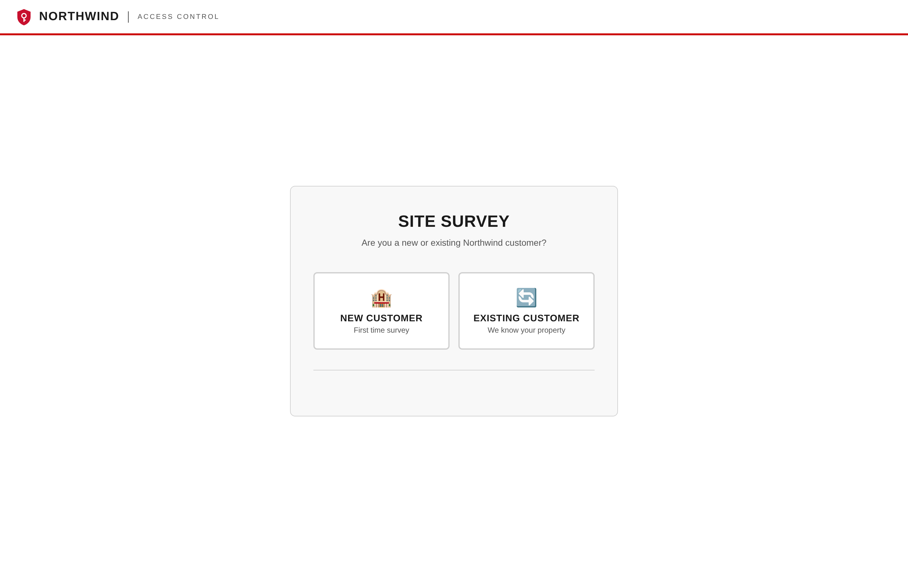

| Project & contact | Counts & inventory |
|---|---|
| 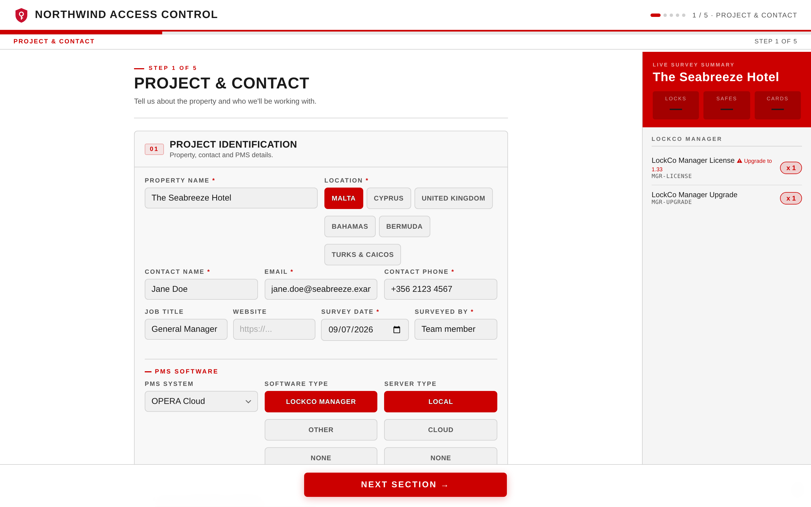 | 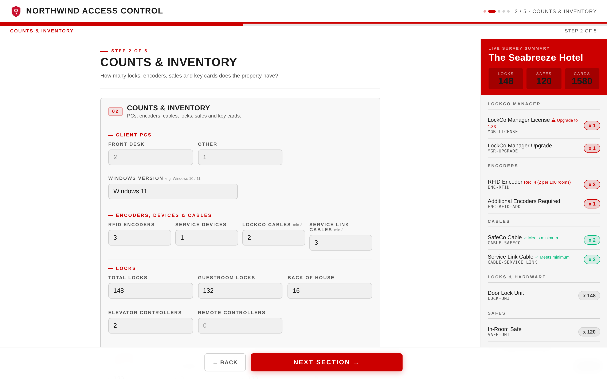 |

### 2. Live bill of materials
As counts are entered, the right-hand panel builds a requirements list: licences, encoders (with a recommended number per 100 rooms), cables checked against minimums, locks, safes and cards. It also flags upgrades, e.g. the lock-management software needs upgrading before newer cards can be used.

### 3. Lock configuration with guided photo capture
The surveyor picks brand, model, case standard, faceplate width, electronics version and handle. They then photograph the lock from four angles. Each photo slot shows a red-line **frame guide** drawn from reference images, so photos come back consistent enough for the AI to use. Every photo goes through a confirm/retake step.

| Lock details | Photo slots | Confirm / retake |
|---|---|---|
| 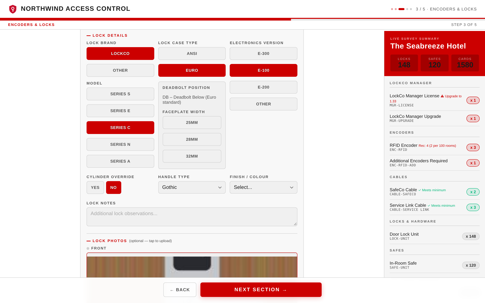 | 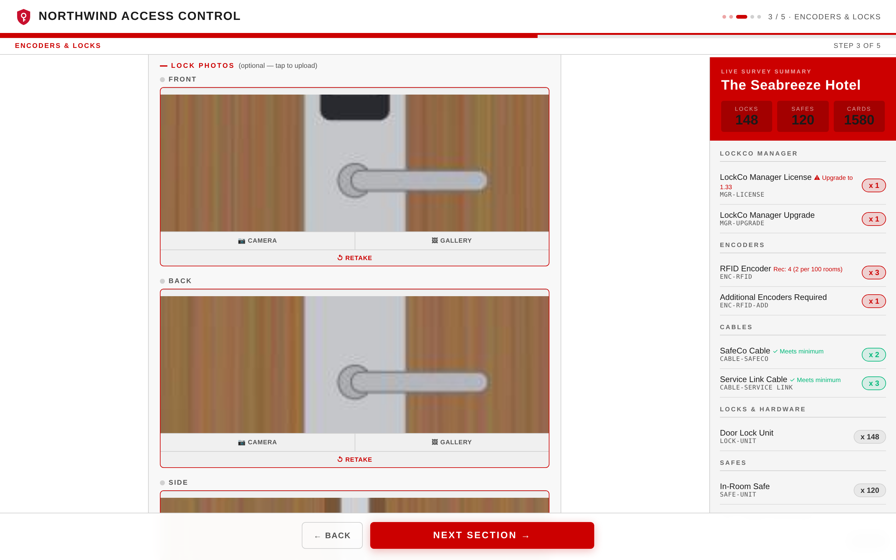 | 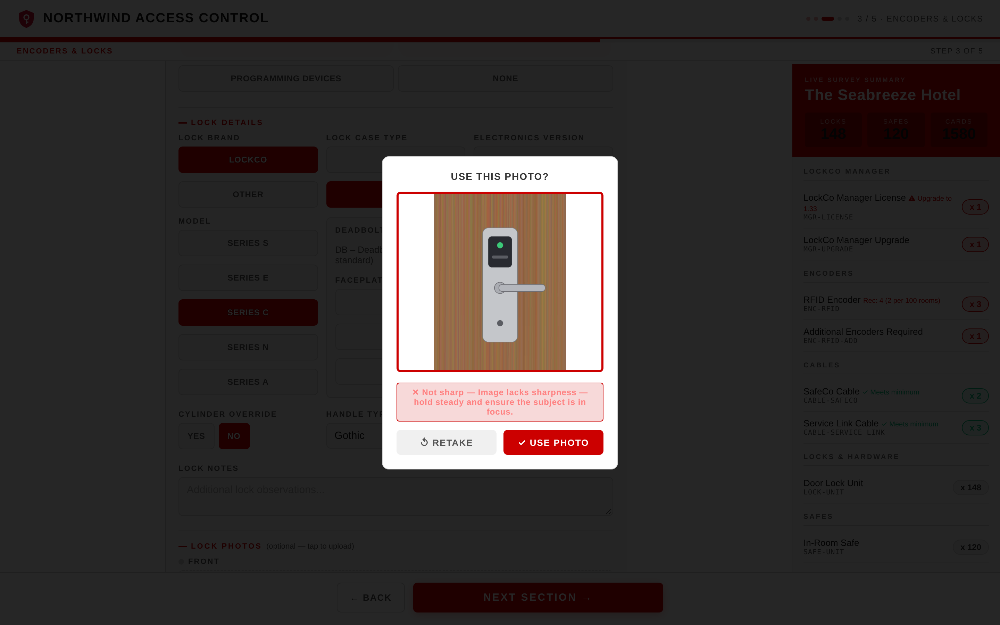 |

The photo guides are built for phones, where most surveys happen:

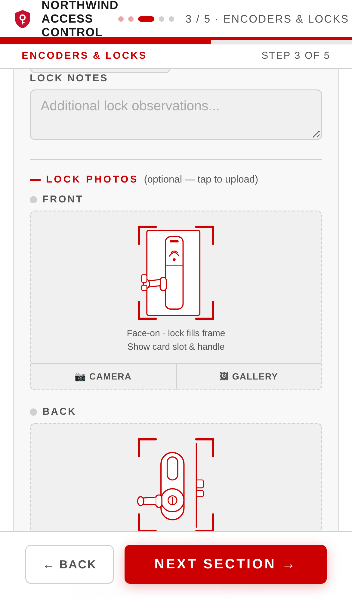

### 4. Safes, spare parts and service equipment
Safe type, condition and a photo, plus tap-to-activate spare-part rows with inline quantities that feed the bill of materials.

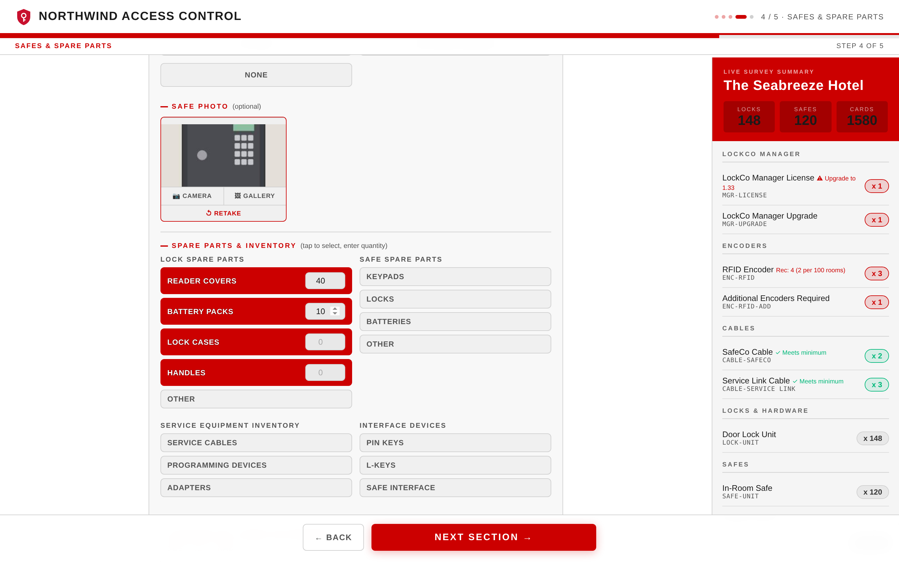

### 5. Compatibility checks that block bad orders
The app knows which card technologies work with which lock-management software versions. Legacy cards on new firmware, or new cards on old firmware, raise a blocking error and the survey can't be submitted until it's resolved. Old-but-workable setups get an amber upgrade warning instead.

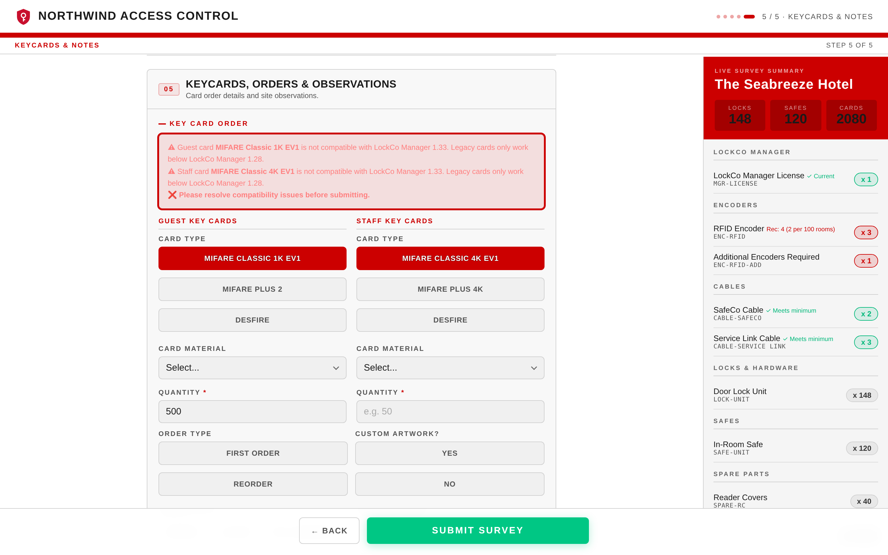

### 6. Submit, then AI analysis
On submit, the backend:
- runs **lock identification** on all four photos concurrently and votes across angles;
- transcribes and summarises the surveyor's **voice note** (Whisper plus a summariser);
- generates a styled **PDF report**;
- asks an LLM for a **structured analysis** (condition score, compatibility flags, internal summary, customer summary, customer recommendations);
- queues the photos for **labelling**, so every survey also grows the training set.

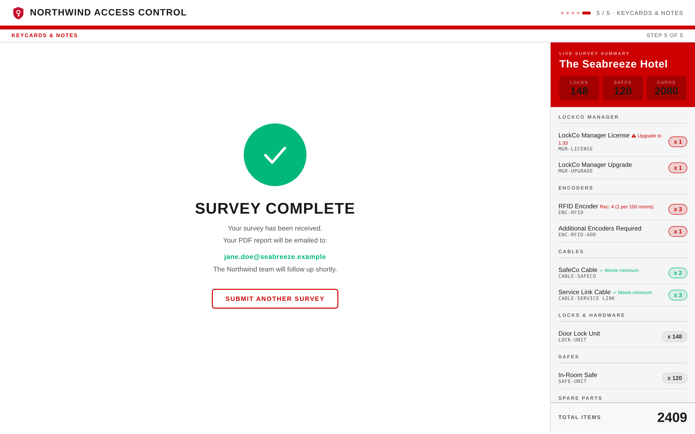

### 7. Human review before anything reaches the customer
Each submission lands on a two-panel review page:
- **Customer preview** (left): risk factors, photos, voice-note summary, the customer-facing assessment, and recommendations the reviewer can edit inline.
- **Internal only** (right): condition score, compatibility flags, AI lock detection and the technical analysis.

**Approve & Send** emails the customer and files the PDF in the client's Drive folder.

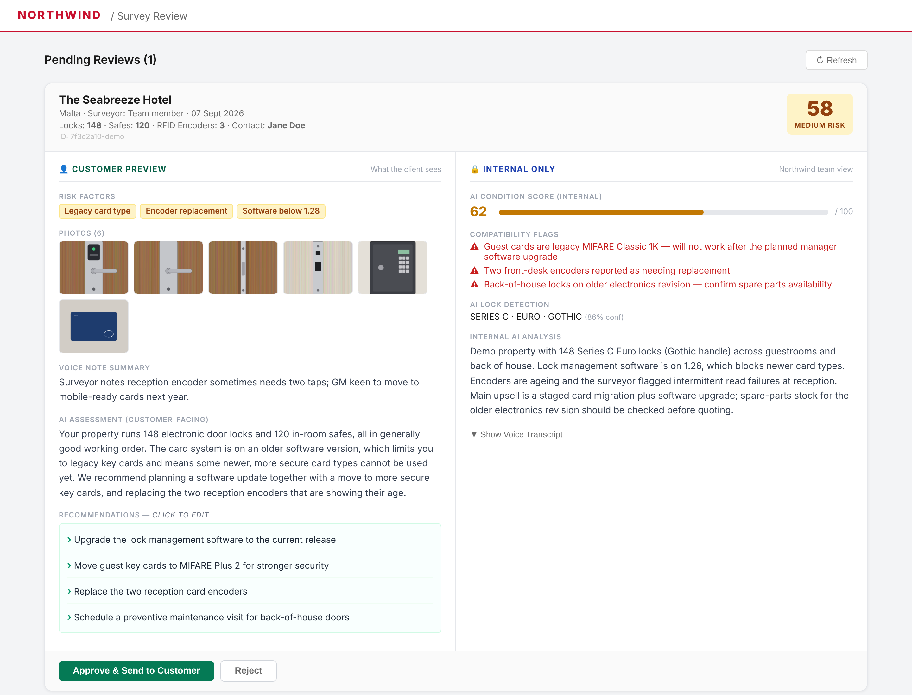

### 8. Lock-ID review and the labelling loop
Two internal tools close the learning loop:
- **Lock ID Review** shows the AI's guess and confidence per survey, with each photo's individual vote. The team can confirm it, correct the SKU or re-slot a photo.
- **Paperclip** is a fast labelling UI. A photo is tagged on three independent attributes (model / case standard / handle), and once confirmed its DINOv2 embedding is written to pgvector straight away, so the next survey can match against it.

| Lock ID review | Paperclip labelling |
|---|---|
| 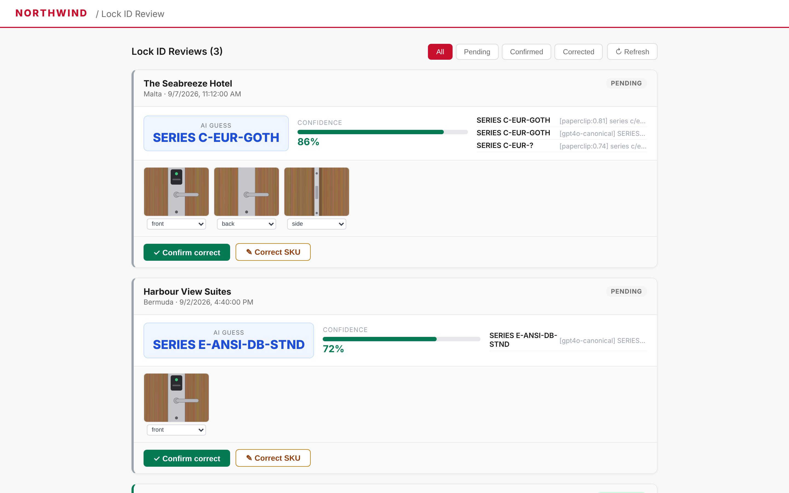 | 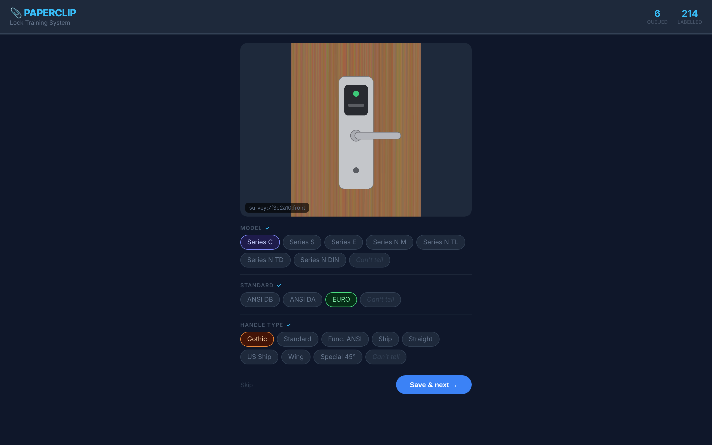 |

---

## How it works

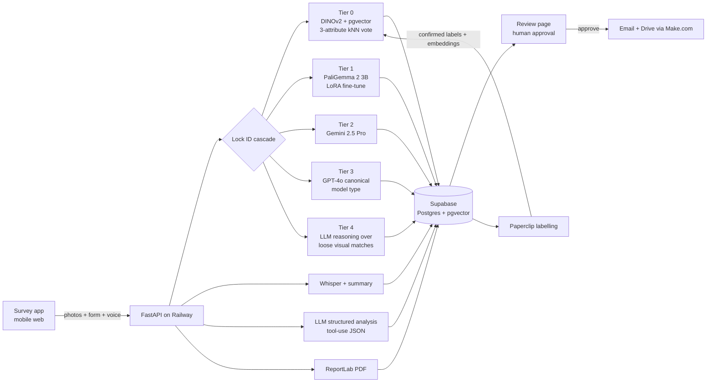

### Lock identification pipeline
For each photo, the pipeline tries the cheapest option first and escalates only when needed:

1. **Tier 0: visual memory.** A DINOv2 embedding (768-d) of the photo is compared with every human-confirmed photo in pgvector (cosine ≥ 0.72, k = 7). The neighbours vote separately on *model*, *case standard* and *handle*, and the result is used when the model vote reaches ≥ 50%.
2. **Tier 1: fine-tuned VLM.** PaliGemma 2 (3B) with a LoRA adapter, served from a Hugging Face Inference Endpoint with a custom handler, is asked for the SKU. The answer is checked against the catalogue.
3. **Tier 2: Gemini 2.5 Pro.** Used when the fine-tuned model's answer isn't a valid catalogue SKU.
4. **Tier 3: GPT-4o canonical check.** Returns a structured `MODEL-STANDARD-HANDLE` ID. It runs for model type whenever no full SKU has been found, because GPT-4o separates the main model families by shape more reliably than embeddings do (see highlights below).
5. **Tier 4: reasoning fallback.** A loose visual search (≥ 0.60) gathers weak candidates, and an LLM (Llama 3.3 70B on Together AI) weighs them against the other tiers' outputs. Its pick is used only if it returns `CONFIRM` and the SKU exists in the catalogue.

At survey level, the four angles are identified **concurrently** and vote. The response carries the winning ID, its weighted confidence, how many photos agreed, and the per-photo evidence for the review screen.

### Model training
- **Base:** `paligemma2-3b-pt-224`, fine-tuned as a VQA task with LoRA (r = 16), 5 epochs, lr 2e-5, fp16, batch 2 × grad-accum 4.
- **Runs:** four training runs so far — a locks-only adapter, then three iterations of a combined locks + safes adapter. Each adapter is merged into the base model and pushed to the Hugging Face Hub.
- **Data:** the first locks dataset is 55 reference images expanded into ~385 question/answer pairs (model, brand, case standard, handle…), plus a captioned safes set. The Paperclip loop now adds human-confirmed real survey photos.

### Results (honest version)
- **What drove the design:** an end-to-end test in June showed that a single fine-tuned model on a small dataset wasn't reliable on its own. It misread one lock as a different brand. That result led to the cascade, the voting across photo angles, and the human review step.
- **No accuracy figure yet:** the fine-tunes ran without a held-out validation split, so I don't quote a percentage. A labelled evaluation set built from confirmed Paperclip photos is the next step.
- **Delivery:** 84 commits on the API between June and September 2026, on top of eleven versions of the survey app itself, evolving from a single-page form with a sticky BOM panel to the current five-step flow.

---

## Engineering highlights

- **Cost-aware model cascade.** The cheap local tiers (vector search, a 3B fine-tune) handle the clear cases. Frontier models are called only on escalation, and an LLM "judge" is the last resort rather than the default.
- **Knowing what embeddings are bad at.** DINOv2 neighbours were clustering by door colour, texture and background, not by lock form factor, so similar-looking models got confused. Model *type* now always comes from a shape-reasoning model, while embeddings still handle fine-grained attributes once enough labelled photos exist.
- **Three-attribute labelling instead of one SKU.** Splitting a long SKU into model / standard / handle makes labelling fast for humans, makes kNN voting work with sparse data, and lets the system return a partial ID ("Series C, Euro, handle unknown") instead of nothing.
- **A loop that learns without retraining.** Every confirmed label is embedded and written to pgvector immediately, so Tier 0 improves day to day. Confirmed photos are also batched into the next periodic fine-tune.
- **Structured LLM output with fallback.** The survey analysis uses forced tool-use to return a strict JSON schema (score, flags, two summaries, recommendations), with an automatic fallback to a second provider if the first call fails.
- **Customer-safe by construction.** Internal analysis (SKUs, compatibility flags, upsell notes) and customer-facing text are generated as separate fields and shown in separate panels. Only the reviewed, editable customer half is ever emailed.
- **Graceful degradation everywhere.** PDF, Drive upload, email, transcription and each identification tier fail independently, and the submission still succeeds with warnings attached. That matters on a hotel corridor with bad signal.

---

Built by **Sebastian Olah**. The source code is private; happy to walk through it in an interview.
